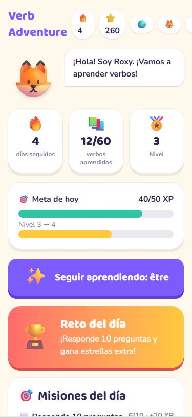
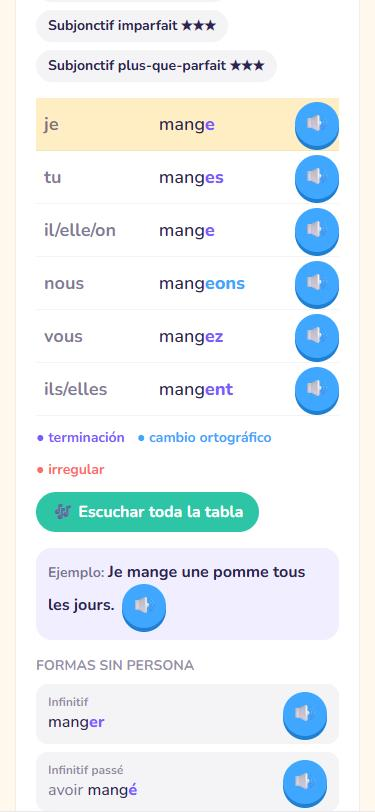
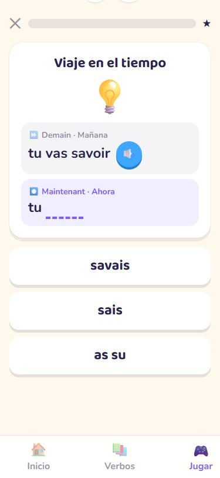
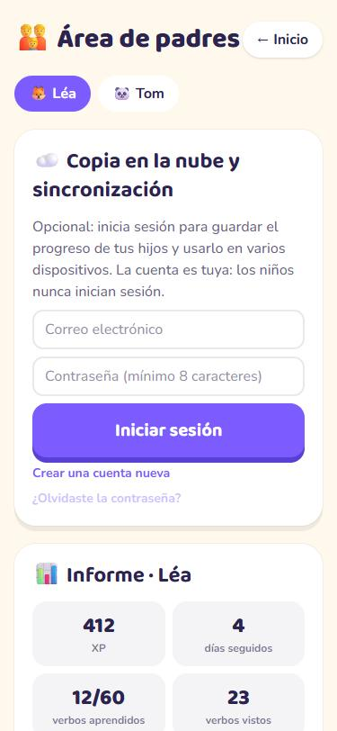

<div align="center">


# Verbidoo

**Master French and Dutch verbs, a few minutes a day.**
Short, playful conjugation games for children, with Gaston 🇫🇷 and Ollie 🇳🇱.

[**▶ Try it at verbidoo.quest**](https://verbidoo.quest) · [Contribute](CONTRIBUTING.md) · [Report a wrong form](../../issues/new?template=content_correction.yml)

[](https://github.com/oscarandrespabonestrella/verbidoo/actions/workflows/ci.yml)
[](LICENSE)
[](LICENSE-CONTENT.md)
[](CONTRIBUTING.md)
[](https://www.buymeacoffee.com/oscarandrespabon)

</div>

---

## What it is

Verbidoo is a free, ad-free web app (installable as a PWA, works offline) that helps children practise verb conjugation in a language they're learning, explained in a language they already speak.

| Learn | Variants | Explained in |
|---|---|---|
| 🇫🇷 French | France (`fr-FR`), Québec (`fr-CA`) | English, Spanish, Portuguese, French, Italian (with their regional variants) |
| 🇳🇱 Dutch | Netherlands (`nl-NL`), Flanders (`nl-BE`) | |

<p align="center">
  
  
  
  
</p>

## Features

- **60 everyday verbs**, each with a picture, real example sentences, translations and a full conjugation table. A comparison panel shows the same verb in the child's own language.
- **14 French and 11 Dutch tenses** that unlock step by step, from the present to the subjunctive.
- **8 games**: Picture, Listen, Conjugate, Complete the ending, Time Travel, Translate, Build a sentence and Pronounce.
- **Adaptive practice**: spaced repetition (Leitner boxes) brings back the verbs and tenses a child finds tricky.
- **Real voices**: every French and Dutch phrase is pre-recorded, with a regional accent per variant, and plays offline.
- **Missions, XP, badges and characters** to keep it fun, plus a gentle "break time" reminder.
- **Several children per device**, each with their own profile, languages and progress.
- **Parent area** behind a grown-up check: progress reports, rules, voice choice and optional cloud sync between devices.

## Privacy first

Verbidoo is built for children, so:

- **No account is needed.** Progress lives on the device (localStorage).
- **No ads, trackers, analytics, chat or uploads.**
- Cloud backup is **optional** and opened by a parent. Only a nickname, an avatar and learning progress are ever synced: never real names, emails of children or voice recordings.
- Automatic voice checking in the Pronounce game is **off by default**. It uses the browser's own speech recognition, which may send audio to the browser maker, so only a parent can turn it on. Children can always just listen and repeat instead.

## Run it locally

You need [Node.js 24](https://nodejs.org/).

```bash
git clone https://github.com/oscarandrespabonestrella/verbidoo.git
cd verbidoo
npm install
npm run dev
```

Open <http://localhost:5173>. The dev server is also reachable from phones on your network.

| Command | What it does |
|---|---|
| `npm run dev` | Development server |
| `npm test` | Unit tests (engine, games, sync, audio coverage) |
| `npm run build` | Type check + production build in `dist/` |
| `npm run check:fr` | Compares every generated form with Wiktionary (`check:nl` for Dutch only) |
| `npm run audio:list` | Regenerates the list of phrases that need a recording |

Cloud sync is optional: copy `.env.example` to `.env.local` and follow [docs/CLOUD.md](docs/CLOUD.md).

## How it works

- **React 19, Vite, Tailwind CSS 4, TypeScript.** Local-first, hash-based routing, lazy-loaded pages, a precaching service worker.
- **A rule-based conjugation engine** (`src/engine/`) generates regular forms; only irregular forms are written by hand (`src/data/`). Every form is checked by tests and against Wiktionary.
- **Verbs are concepts** (`eat`) with one lemma per language, so translations and comparisons come for free.
- **Languages are configuration** (`src/data/targets.ts`), so adding a new learning language doesn't mean touching every component.

Detailed docs: [Architecture](docs/ARCHITECTURE.md) · [Audio](docs/AUDIO.md) · [Cloud accounts](docs/CLOUD.md)

## Contributing

Contributions are very welcome, and you don't need to be a developer:

- 🗣️ **Native speakers**: irregular forms, sentences and translations haven't been reviewed by native speakers yet. Spotting one mistake already helps. [Report a correction](../../issues/new?template=content_correction.yml).
- 💻 **Developers**: new games, accessibility, performance, a new language.
- 🎨 **Illustrators**: mascot moods, scenes, icons.
- 👩‍🏫 **Teachers and parents**: [share ideas](../../issues/new?template=feature_request.yml) about what helps children learn.

Read [CONTRIBUTING.md](CONTRIBUTING.md) to get started, and please follow the [Code of Conduct](CODE_OF_CONDUCT.md). Found a security or privacy issue? See [SECURITY.md](SECURITY.md).

## Support the project

Verbidoo is free and will stay free, with no ads. If it helps your family or classroom, you can help cover hosting and the voice recordings:

<a href="https://www.buymeacoffee.com/oscarandrespabon"></a>

Starring the repository and sharing the app with other parents and teachers helps too. ⭐

## License

- **Code**: [MIT](LICENSE)
- **Mascots, logo, screenshots and learning content**: [CC BY-SA 4.0](LICENSE-CONTENT.md)
- **Recordings**: Piper voices (CC BY 4.0 / CC0) and cloud text-to-speech output, see [LICENSE-CONTENT.md](LICENSE-CONTENT.md)

If you publish your own version, please give it a different name so families don't confuse it with the official Verbidoo.
